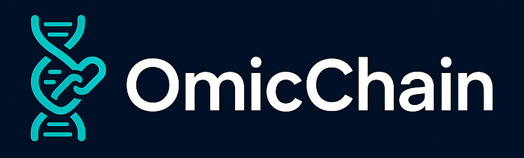

# OmicChain



**Certified, verifiable RNA-seq differential expression analyses.**

[](https://github.com/UR24144-ProDiCeT/OmicChain/actions/workflows/tests.yml)
[](LICENSE.txt)

OmicChain runs a differential expression analysis and makes it checkable by anyone. Every component of
the analysis is hashed; the hashes are combined into one **composite SHA-256 fingerprint**, which is
published on the [Base](https://base.org) blockchain as a public, dated record. A PDF certificate and
an [RO-Crate](https://www.researchobject.org/ro-crate/) are produced; from the crate, a reviewer can
check the fingerprint and re-run the analysis, down to the raw sequencing files.

It is a local application (Streamlit) meant for biologists as well as bioinformaticians, on Windows,
Linux and macOS.

## What it does

1. **Data & reference** — start from a public study (GEO / SRA accession: FASTQ files are downloaded
   from the ENA and checked against its md5), your own FASTQ files, or a count matrix. FASTQ files are
   aligned and counted with Rsubread on a GENCODE reference that OmicChain downloads, builds and
   fingerprints. Samples can be annotated in the application.
2. **Analysis** — choose the compared samples and an optional covariate (`~ covariate + group`),
   look at a quality control (PCA, library sizes, alignment rates) and at the effect of the thresholds,
   then run DESeq2 (Snakemake).
3. **Blockchain proof** — the fingerprint is published by your own account on Base (testnet or mainnet).
4. **Certificate** — a PDF with an annex listing every raw file and its checksum, and an RO-Crate
   holding the certified files.
5. **Verify** — check a fingerprint on-chain, and re-run a crate: from the expression table (minutes)
   or from the raw data (FASTQ downloaded again or provided, or the original matrix).

## What is certified

| Component | Content |
|---|---|
| Analysis code | `Snakefile`, `run_deseq2.R`, `de_core.R` |
| Parameters | adjusted p-value and log2 fold-change thresholds, covariate |
| Input data | expression table and sample metadata |
| Data origin | accession, each raw file with its checksum, reference and index fingerprints, alignment and counting settings, SHA-256 of the alignment / counting code, your sample annotations |
| R environment | `renv.lock` |
| Results | table of differentially expressed genes |

The blockchain proves that this fingerprint existed at a date and was published by an address
(optionally linked to an ORCID iD). It does not prove that an analysis is scientifically right.

## Install

Python 3.10 or later (tested with 3.13) and R 4.5.x (the R packages are pinned to Bioconductor 3.22).

```
pip install -r requirements.txt
Rscript -e "renv::restore()"
copy .env.example .env          (macOS / Linux: cp .env.example .env), then fill it in
streamlit run OmicChain.py
```

Details, including the exact R environment (`renv`), are in [INSTALL.md](INSTALL.md). Read
[SECURITY.md](SECURITY.md) before using a real account: the application holds a publishing key.

To try it without sequencing data, choose "A count matrix" in the first step and load
`examples/simulated_counts.tsv`.

## Verify a certified analysis

```
python omicchain_verify.py omicchain-crate.zip --expected <fingerprint read on-chain>
python omicchain_verify.py omicchain-crate.zip --from-raw          (from the raw data)
```

or use the Verify step of the application, or the public page
<https://ur24144-prodicet.github.io/OmicChain/> to look a fingerprint up on-chain. See
[VERIFY.md](VERIFY.md).

## Documentation

| | |
|---|---|
| [INSTALL.md](INSTALL.md) | installation |
| [VERIFY.md](VERIFY.md) | verifying and re-running a certified analysis |
| [SECURITY.md](SECURITY.md) | what protects an installation, what is your responsibility |
| [IDENTITY.md](IDENTITY.md) | linking the publishing account to an ORCID iD |
| [PORTAL.md](PORTAL.md) | the public verification page |
| [PLUGIN.md](PLUGIN.md) | certifying another pipeline with the same core (`omicchain.json`) |
| [CHANGELOG.md](CHANGELOG.md) | versions |

## Tests

```
pip install -r requirements-dev.txt   (test-only packages)
python tests/run_all.py fast        (no R needed: a mock Rscript stands in for DESeq2; Linux / macOS)
python tests/run_all.py portable    (pure Python; also on Windows)
python tests/run_all.py upstream    (real Rsubread on small simulated genomes; R + Bioconductor)
```

## Citation and licence

See [CITATION.cff](CITATION.cff). OmicChain is distributed under the GNU Lesser General Public
License v3 ([LICENSE.txt](LICENSE.txt)); the smart contract `Proof.sol` is under the MIT licence.
Third-party components: [THIRD_PARTY_LICENSES.md](THIRD_PARTY_LICENSES.md).

© 2026 Pierre-Olivier Guichet — UR24144 ProDiCeT, Université de Poitiers / CHU de Poitiers.
